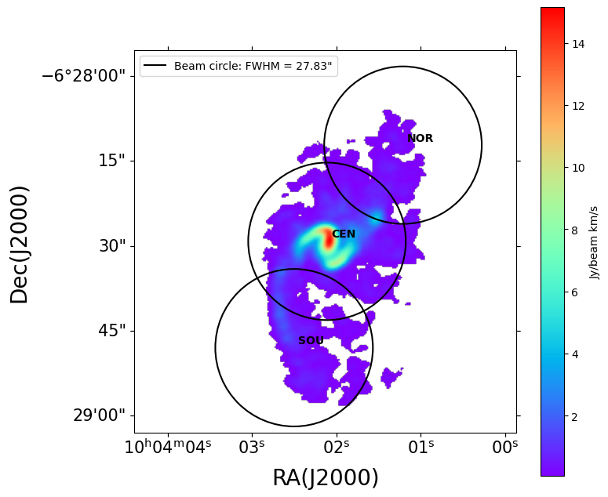
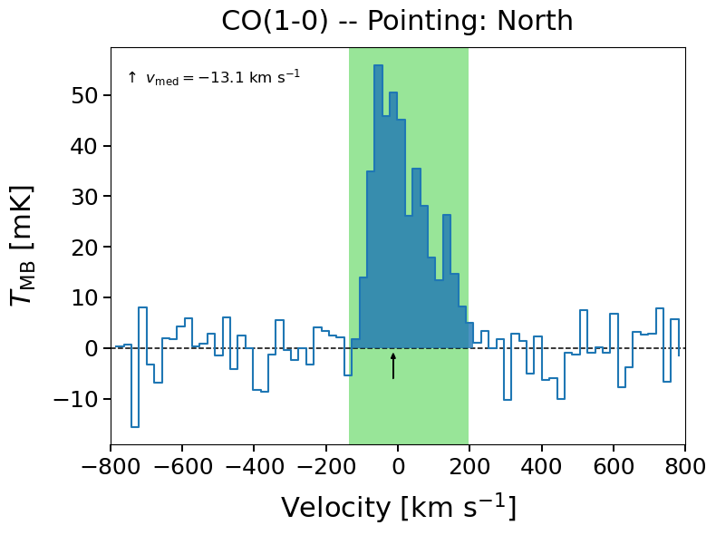
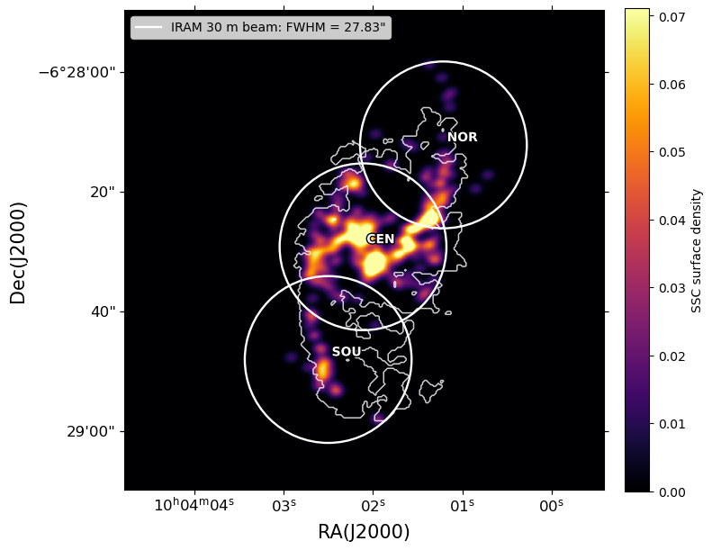

# Molecular Gas and Star Formation in NGC 3110

**Bachelor's Thesis in Physics (2025–2026)** · **Pablo Martínez González**

Scientific data analysis of the molecular gas in the interacting luminous infrared galaxy **NGC 3110**, examining whether regional molecular conditions are associated with intense star formation and populations of super star clusters (SSCs).

> **Data availability:** Original telescope observations, ALMA FITS maps and third-party observational data are **not distributed** because the author does not hold the rights to redistribute them. This repository includes the analysis scripts, methodological documentation and the original notebooks’ saved figures and tabular results. **Derived visualizations may still be subject to third-party publication conditions; confirm permissions with the supervisor before making the repository public.** **A complete rerun requires privately obtained authorized data; full reproduction has not been independently verified.**

## Research objectives

The original study compared the northern spiral arm, the galaxy center and the southern spiral arm to evaluate:

1. The intensities and kinematics of CO(1–0), CO(2–1), HCN(1–0), HCO⁺(1–0) and HNC(1–0).
2. Molecular excitation and dense-to-bulk gas-tracer ratios, using beam-matched IRAM 30 m and ALMA observations.
3. Possible associations between the gas properties and the surface density of SSC candidates.

## Analytical workflow

**IRAM 30 m spectroscopy** → reduction and Gaussian fitting with **GILDAS/CLASS** → integrated intensities and error estimates → structured `.dat` tables → **Python**-based flux conversion and quantitative analysis.

**ALMA CO moment-0 maps** → FITS/WCS reading → Gaussian simulation of IRAM beam response → beam-matched fluxes → regional comparisons.

**SSC candidate maps** → aperture/CO-mask measurements → cluster counts and surface densities → comparison with molecular-line diagnostics.

**Technologies:** Python, pandas, NumPy, SciPy, Astropy, Matplotlib, Jupyter Notebook and GILDAS/CLASS.

## Selected figures from the original analysis







All figures shown here were extracted from saved notebook outputs. The source data are not included.

## Selected findings from the thesis

| Quantity | North | Center | South |
| --- | ---: | ---: | ---: |
| HCN(1–0)/CO(1–0) | 0.040 ± 0.012 | 0.034 ± 0.005 | 0.047 ± 0.008 |
| HCO⁺(1–0)/CO(1–0) | 0.042 ± 0.011 | 0.041 ± 0.005 | 0.037 ± 0.008 |
| SSC surface density (kpc⁻²) | 3.24 | 5.37 | 1.63 |

The center has the strongest absolute molecular emission, but **not** the largest nominal HCN/CO ratio. Dense-gas tracer ratios do not show a simple monotonic relationship with SSC surface density across these three large regions. HNC is securely detected only in the center. Angular resolution and interferometric missing flux constrain the interpretation. These numbers are quoted from the **original thesis**, not from a fresh execution of the adapted scripts.

## Repository guide

| Location | Contents |
| --- | --- |
| [`notebooks/01_alma_maps_and_fluxes.ipynb`](notebooks/01_alma_maps_and_fluxes.ipynb) | FITS maps, simulated IRAM beams and CO fluxes |
| [`notebooks/02_spectral_visualization.ipynb`](notebooks/02_spectral_visualization.ipynb) | Spectral displays and fitted lines |
| [`notebooks/03_hnc_upper_limits.ipynb`](notebooks/03_hnc_upper_limits.ipynb) | Non-detection and upper-limit calculations |
| [`notebooks/04_molecular_ratios.ipynb`](notebooks/04_molecular_ratios.ipynb) | Line ratios and error propagation |
| [`notebooks/05_star_cluster_maps.ipynb`](notebooks/05_star_cluster_maps.ipynb) | SSC spatial distribution and CO mask |
| [`gildas/`](gildas/) | Research-specific CLASS reduction and export scripts |
| [`src/convert_to_jy.py`](src/convert_to_jy.py) | Key-validated conversion of CLASS tables to Jy km/s |
| [`docs/REPRODUCIBILITY.md`](docs/REPRODUCIBILITY.md) | Required private data and outstanding consistency checks |
| [`docs/PUBLISHING.md`](docs/PUBLISHING.md) | Safe publication procedure |

All 26 available saved maps and spectral plots (8 ALMA plots, 15 spectral plots, 3 SSC images) are embedded in the relevant Jupyter notebooks, alongside the available archived result tables. These are **historical saved outputs**, not freshly generated by the adapted code. Most figures now display inline by default; derived intermediate `.dat` tables may still be written because downstream notebooks require them. The source code has been made independent of machine-specific Python paths.

## Setup

Python 3.10+ is recommended. From the repository directory:

```bash
python -m venv .venv
# Windows: .venv\Scripts\activate
# macOS / Linux: source .venv/bin/activate
python -m pip install -r requirements.txt
jupyter lab
```

Launch Jupyter from the repository root or the `notebooks/` folder. The Python code discovers the project root automatically. The original FITS files and spectra are **not included**, so only the code, documentation and embedded historical outputs can be inspected without additional data. GILDAS/CLASS requires a separate installation and research-specific observational files.

If matching CLASS result tables are available, the converter can be run from any directory:

```bash
python src/convert_to_jy.py --results-dir results/ResultadosCLASS
```

## Limitations and acknowledgments

The pipeline was developed for a specific scientific analysis, not as a reusable astronomy software library. Several pre-existing scientific consistency issues, including a labeled HCN/HCO⁺ ratio with reversed numerator/denominator, must be checked against the original observations before claiming numerical reproducibility; see the [reproducibility notes](docs/REPRODUCIBILITY.md). The research is based on IRAM 30 m, ALMA and SSC observational material and scientific literature acknowledged in the thesis. No original restricted observations or thesis PDF are included. Redistribution and licensing rights should be confirmed before selecting an open-source license.
